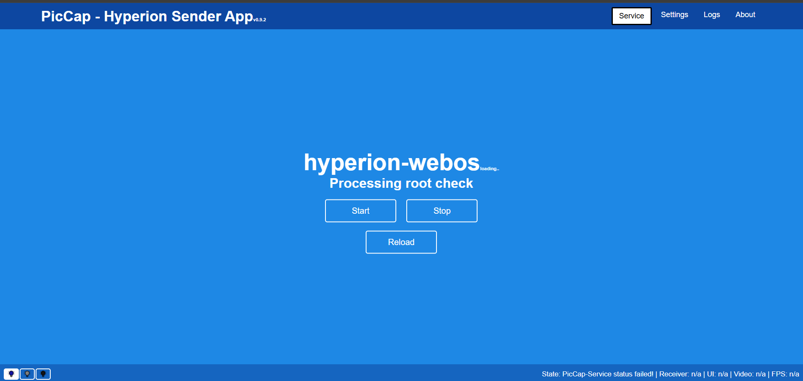
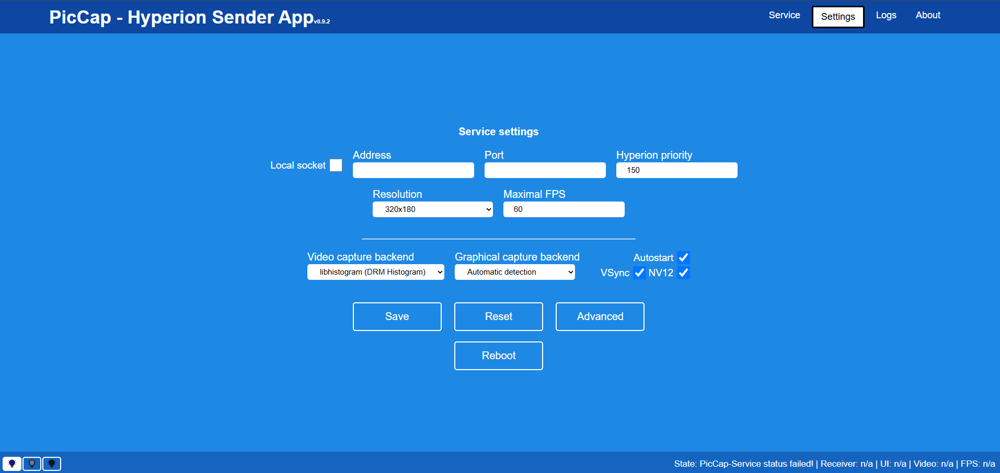
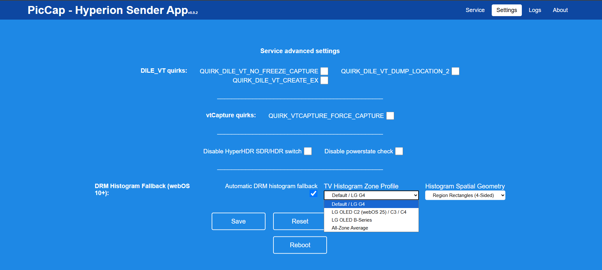
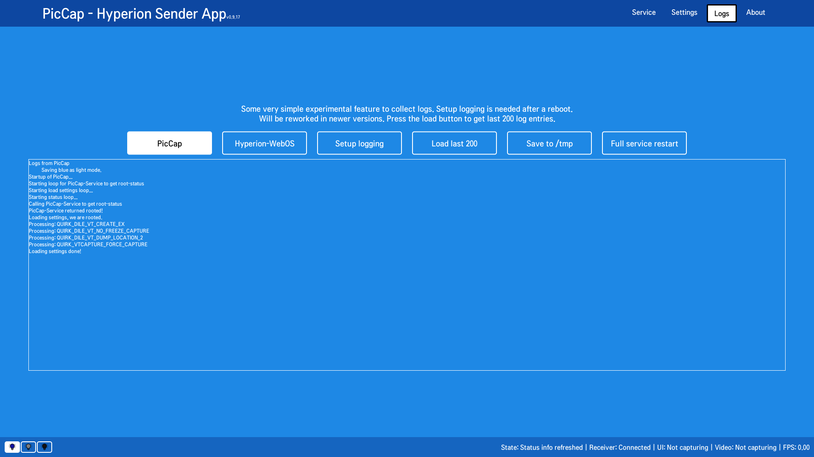
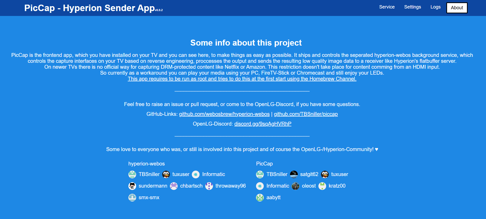

# PicCap - Hyperion Sender App | Ambilight for LG WebOS TVs 

  
## What's this?

### PicCap?    
PicCap is an frontend app, which you can install on your TV, to make TV content capturing as easy as possible. It ships and controls the seperated [hyperion-webos](https://github.com/webosbrew/hyperion-webos) background native service, which uses capture interfaces on your TV based on reverse engineering, proccesses the output and sends as result a low quality image to a receiver like Hyperion's flatbuffer server.  
On newer TVs, standard video capture cannot read DRM-protected content from streaming apps like Netflix, Disney+, or Prime Video. On supported models (webOS 10+ / webOS 23–25+), PicCap now includes an automatic **DRM Histogram Fallback** (`libhistogram`) that seamlessly switches to hardware scaler histogram data during protected playback and returns to normal UI/video capture afterward.

### Hyperion?  
[hyperion.ng](https://github.com/hyperion-project/hyperion.ng) basicly is a server service, which transforms incomming image data to an LED output. The idea is to have an ambilight like it's known from Philipps TVs.
It is used in DIY-environments, like builded up in [this tutorial](https://github.com/TBSniller/piccap/blob/main/docs/DIY_Ambilight.md).  
You can also run [Hyperion.ng webOS loader](https://github.com/webosbrew/hyperion.ng-webos-loader) or it's fork [HyperHDR webOS loader](https://github.com/webosbrew/hyperhdr-webos-loader) directly on your webOS TV, so you don't need any further hardware, expect of your LED driver. Both apps can be found in [Homebrew Channels app repository](https://repo.webosbrew.org/apps/).  
  
https://user-images.githubusercontent.com/51515147/192116249-f5080f02-3566-4c94-b9e1-bdb11aba2698.mp4

This footage is captured on a webOS5-TV using vtCapture as library.

## How to install  

### What do you need?  
- [Root access](https://cani.rootmy.tv) to your TV  
- webOS 3.4 or above  
- Latest version of [Homebrew Channel](https://github.com/webosbrew/webos-homebrew-channel) installed, as we take use of its elevate-service script  
- Brain with some basic knowledge - We haven't encountered any bricks, but standard no warranty clause applies

### Easy way
Open Homebrew Channel and install PicCap directly from there.  
  
### Manual way
First you will have to [build](https://github.com/TBSniller/piccap#development) it from scratch, or download pre-compiled IPK from [releases](https://github.com/TBSniller/piccap/releases).  
  
```
# Copy IPK to TV 
scp /home/[USER]/downloads/org.webosbrew.piccap_[version]_all.ipk root@[TVIP]:/tmp/org.webosbrew.piccap_[version]_all.ipk

# On TV install IPK
luna-send -i -f luna://com.webos.appInstallService/dev/install '{"id":"org.webosbrew.piccap","ipkUrl":"/tmp/org.webosbrew.piccap_[version]_all.ipk","subscribe":true}'
```
  
## How to use
### First start  
Wait a few secounds to let the service elevate root permissions through Homebrew Channel-Service. Check status message in bottom right corner, to see when it's done.
  
  
### Settings 
 - If you use hyperion.ng or HyperHDR loader, you will have to fill `127.0.0.1` as IP address. 
 - Change priority if you have other capture or effect sources for your Hyperion or HyperHDR instance.  

### Backends
We use different libraries to capture TVs content. These are used by hyperion-webos and described [here](https://github.com/webosbrew/hyperion-webos/tree/main#backends).  

### Advanced settings
Some TV models are compatible with a specific backend, but require a slightly different routine to work reliably. You can find an explanation for these so-called quirks [here](https://github.com).

#### DRM Histogram Fallback (webOS 10+)
On supported LG TVs (e.g., OLED C2 on webOS 25, C3, B4, C4, G4, and QNED models running webOS 10+ / webOS 23–25+), enabling **Automatic DRM histogram fallback** allows PicCap to capture ambient lighting from DRM-protected streaming apps:
- **Automatic Handover & Return:** Automatically switches from `libvtcapture` to `libhistogram` when protected playback starts, and restores normal UI (`libhalgal`) and video (`libvtcapture`) capture when exiting back to Home or unprotected sources.
- **TV Histogram Zone Profile:** Choose the zone layout matching your TV (`Default / LG G4`, `LG OLED C2 (webOS 25) / C3 / C4`, `LG OLED B-Series`, or `All-Zone Average`).
- **Histogram Spatial Geometry:** Choose between `Region Rectangles (4-Sided)` and `Perimeter (Rim)` projection.
- **One-Click Log Export (`Save to /tmp`):** In the **Logs** tab, click **Setup logging** (once after reboot), reproduce an issue, and press **Save to /tmp** to export TV/webOS device info along with the last 500 `hyperion-webos` log lines to `/tmp/piccap.log`.

## Development
### Dependencies
To build PicCap and hyperion-webos you will need:  
- [Node.js](https://nodejs.org/en/download/)  
- [buildroot-nc4](https://github.com/openlgtv/buildroot-nc4)  

You will also need `clang-format-14` if you want to contribute.  

### How to build  
We have tried to make build process as easy as possible. After building all files can be found in `./build`.
```
# Setup buildroot-nc4 (needed for hyperion-webos)
cd /desired/path
wget -O toolchain.tar.gz $TOOLCHAIN_URL_FROM_RELEASES
tar -xvzf toolchain.tar.gz
rm toolchain.tar.gz
arm-webos-linux-gnueabi_sdk-buildroot/relocate-sdk.sh
export TOOLCHAIN_FILE=/desired/path/arm-webos-linux-gnueabi_sdk-buildroot/share/buildroot/toolchainfile.cmake

# Clone project and submodules
git clone --recursive https://github.com/TBSniller/piccap.git
cd ./piccap

# Install node dependencies
npm install

# Build
npm run-script build-all        # Build PicCap & hyperion-webos + deps
npm run-script build-frontend   # Build PicCap only
npm run-script build-backend    # Build hyperion-webos + deps only

# Package IPK-file for TV installation
npm run-script package
```  

## Other

### Known issues  
**Expect bugs - This app is still in early development**  
Attention! New AI options have been added to newer LG models.
Since the 'AI Picture Pro', 'AI Brightness', 'AI Genre Selection', 'AI Image Game Optimizer' and 'AI Game Sound' options use the same recording process as Hyperion WebOS, dropouts may occur during recording. Consequently, a live preview in HyperHDR is temporarily unavailable, and the LEDs also switch off briefly.

Workaround:
Deactivate these options (can be found under “Settings” > ‘General’ > “AI service”). Depending on the model, this can also be done under “Settings” > ‘General’ > “AI service”.

Please see [hyperion-webos#known-issues](https://github.com/webosbrew/hyperion-webos/tree/main#known-issues) for issues regarding the backend service. - This only is the frontend application and has nothing to do with capture related things!  
Version tracker is available in [hyperion-webos#16](https://github.com/webosbrew/hyperion-webos/issues/16). 

### Credits
This project would never ever exist without help from [@Mariotaku](https://github.com/mariotaku) and [@Informatic](https://github.com/Informatic).
Both programmed important things at the beginning of this whole ambilight project. [@tuxuser](https://github.com/tuxuser) also made some important changes in the mid of this project.  
Share them some love if you can, they taught and showed me alot!

Special thanks also to [@matze19999](https://github.com/matze19999/HyperDRM) for pioneering LG's `vtCapture_*Histogram` approach for DRM ambient lighting on webOS, which inspired the `libhistogram` fallback backend.  

You should also check out the other contributors. Some nice enhancements wouldn't be there without them :)  
  
Check out [OpenLGs-Discord](https://discord.gg/9sqAgHVRhP) server, if you have some questions. You will find a very helpful community. <3  

### Screenshots





